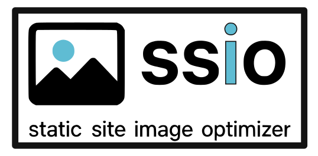

# Static Site Image Optimizer (ssio)



Recursively converts images in a directory to WebP and updates references in HTML/CSS/JS files, quickly and safely

## Installation

```bash
git clone https://github.com/ToledoEM/StaticSiteImageOptimizer.git
cd StaticSiteImageOptimizer
chmod +x ssio
```

Requires [uv](https://docs.astral.sh/uv/). The first run creates `.venv` and installs dependencies.

To use `ssio` globally, add a symlink:

```bash
sudo ln -s $(pwd)/ssio /usr/local/bin/ssio
```

## Usage

Convert all images in a directory to WebP:

```bash
./ssio /path/to/directory
```

Or if installed globally:

```bash
ssio /path/to/directory
```

### Options

- `--quality <0-100>` - WebP quality (default: 80)
- `--dry-run` - Preview changes without making them
- `--backup` - Create .bak copies of modified files
- `--delete-original` - Remove original images after conversion
- `--extensions <list>` - Comma-separated image extensions (default: .jpg,.jpeg,.png,.gif,.bmp,.tiff)
- `--include <list>` - Comma-separated text file extensions to update (default: .html,.css,.js)
- `--log-level <level>` - DEBUG, INFO, WARNING, ERROR (default: INFO)

### Examples

Basic usage:

```bash
./ssio .
```

Custom quality with backup:

```bash
./ssio /path/to/site --quality 85 --backup
```

Dry run mode:

```bash
./ssio . --dry-run
```

Delete originals:

```bash
./ssio . --delete-original
```

Custom file extensions:

```bash
./ssio . --extensions .jpg,.png --include .html,.css
```

Complete example:

```bash
./ssio . --quality 80 --backup --dry-run --log-level DEBUG
```

## Features

- Recursively scan directories for image files and convert them to WebP
- Update references across HTML, CSS, and JS files to use the generated WebP files
- Dry-run mode to preview changes
- Optional deletion of original files after successful conversion
- Optional backup of modified files (creates .bak)
- Configurable quality settings (0-100)
- Support for multiple image formats (jpg, jpeg, png, gif, bmp, tiff)
- Colour-accurate output: embedded ICC profiles (Adobe RGB, ProPhoto, Display P3, CMYK) are converted to sRGB, and EXIF data is kept

## Notes

- The tool replaces references by matching filenames and computing relative paths
- This is pragmatic and may not cover all edge cases (e.g., dynamic JS templates or complex srcset handling)
- Add original image formats to .gitignore but keep WebP files tracked
- Safety checks prevent running as root or at filesystem root directories
- Use `--backup` flag to create .bak files that can be reverted

## Reverting Changes

To revert changes made by ssio:

```bash
./ssio-revert /path/to/directory
```

Options:

- `--remove-webp` - Also remove .webp files
- `--dry-run` - Preview what would be reverted
- `--extensions <list>` - File extensions to revert (default: .html,.css,.js)

## Test

To test the tool with sample data:

```bash
cd test
./download_images.sh
uv run test_conversion.py
```

This will convert images in `test/img/` and update references in `test/index.html` without deleting originals.

## Complete Example

The `test/` folder holds a demo page that uses four Wikimedia Commons images as `` tags, a CSS `background-image` and a `./` relative path. Each card on the page shows the file size the browser downloaded.

- [Original vs WebP, side by side](compare.qmd) with the file size under each image
- [Test page with original images](test/index.html) (JPG/PNG)
- [Same page after ssio](test/index_compressed.html) (WebP)

Run it yourself:

```bash
cd test
./download_images.sh
../ssio . --quality 85 --backup
```

`download_images.sh` fetches the full-resolution files from Wikimedia Commons and resizes them to web size (max 1600 px on the long side), keeping their colour profiles. ssio then converts every image in `test/img/`, rewrites the references in `test/index.html` and saves the original page as `test/index.html.bak`. Restore it with `../ssio-revert . --remove-webp`.

Results at `--quality 85`:

| Image | Full-resolution source | Resized original | WebP | Saved |
| --- | ---: | ---: | ---: | ---: |
| [Eye of the Bird](https://commons.wikimedia.org/wiki/File:Arara-vermelha_-_PARNA_da_Serra_da_Capivara_-_LeonardoRamos(001).jpg) (JPG, ProPhoto RGB) | 6.63 MB | 0.50 MB | 0.21 MB | 58.1% |
| [Raya de arrecife](https://commons.wikimedia.org/wiki/File:Raya_de_arrecife_(Taeniura_lymma),_mar_Rojo,_Egipto,_2023-04-14,_DD_64.jpg) (JPG, sRGB) | 8.76 MB | 0.87 MB | 0.44 MB | 49.9% |
| [Jupiter](https://commons.wikimedia.org/wiki/File:Jupiter_accurate_colour.png) (PNG) | 2.58 MB | 1.18 MB | 0.06 MB | 94.6% |
| [Val Montanaia](https://commons.wikimedia.org/wiki/File:Val_Montanaia.jpg) (JPG, Adobe RGB) | 38.04 MB | 0.63 MB | 0.36 MB | 42.9% |
| **Total** | **56.01 MB** | **3.18 MB** | **1.07 MB** | **66.5%** |

Saved compares the resized original with its WebP. Sizes are in MiB (1 MB = 1,048,576 bytes), measured with ssio 0.1.0 and Pillow 12. Wide-gamut originals (Adobe RGB, ProPhoto) are colour-converted to sRGB, so the WebP files look the same as the originals in every browser.

## Render Site

To render the documentation site using Quarto:

```bash
quarto render
```

## License

This project is licensed under the MIT License - see the `LICENSE` file for details.
